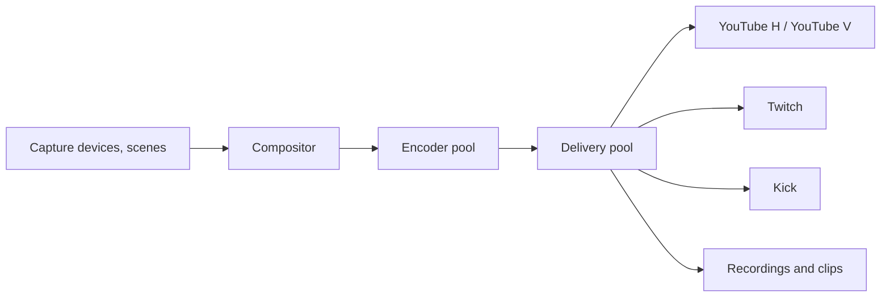

<div align="center">
  <!-- TODO: confirm logo path -->
  <h1>Ujwalam</h1>
  <h4>A local-first streaming studio for Windows: go live, record and make clips, all on your own PC.</h4>

  <p>
    
    
    
  </p>

  <p>
    <a href="#-what-it-does">What it does</a> •
    <a href="#-get-started">Get started</a> •
    <a href="#-how-it-works">How it works</a> •
    <a href="#-faq">FAQ</a> •
    <a href="#-for-developers">For developers</a>
  </p>
</div>

Ujwalam is a streaming studio for people who stream from one Windows PC. It has an easy studio
layout, a built-in video engine (libobs), AI clipping, and scenes and effects your chat can
trigger. For example: stream to YouTube (wide and vertical), Twitch and Kick at once, press
**Save clip** when something good happens, and upload the clip to your own channel later.

It runs only on your computer. It has no server, no user accounts, no advertising and no
analytics. See [PRIVACY.md](PRIVACY.md).

> [!WARNING]
> Ujwalam is **alpha** software. Builds are made from this project folder; there is no public
> download yet. Stream keys stay in Windows Credential Manager only.

## ✨ What it does

- 🎥 **Studio with a built-in engine** – scenes, layers and capture devices on embedded libobs.
- 📡 **Many outputs at once** – one compositor feeds a shared pool of encoders, so YouTube
  (wide and a separate 9:16 vertical output), Twitch and Kick can run together. Audio is encoded
  once.
- ✂️ **Clips and moments** – **Record**, **Save clip** and **Mark moment**, with AI clipping.
- ⬆️ **Upload clips to YouTube** – as private videos on your own channel, in a free time slot.
- 💬 **Chat-driven scenes and effects** – presets are data; chat and rules never act on their own,
  they wait for one click from you.
- 🔑 **Keys stay safe** – stream keys and Google sign-in tokens live only in Windows Credential
  Manager.
- 🧰 **Easy install, update, repair and roll back** – one setup program, no admin rights, and a
  settings backup before every switch.
- 🚩 **New features behind switches** – off by default, and you can switch them from the control
  page while live.

## 🚀 Get started

You need Windows 11, Node.js 22.13 or newer on PATH, and the Microsoft Visual C++ 2015-2022 x64
runtime. The installer checks both and says if one is missing; it installs nothing itself.

1. **Get the setup program.** Builds are made in the project folder: run `npm run build:setup`
   once, then `npm run package:alpha`. The build folder `out\dist` then holds
   `Ujwalam-Setup-<version>.exe` (one file; it checks itself first).
   <!-- TODO: confirm whether a downloadable release is planned -->
2. **Double-click `Ujwalam-Setup-<version>.exe`.** It needs no admin rights and installs into
   `%LOCALAPPDATA%\Ujwalam`. The window offers one button: **Install**, **Update to
   <version>**, or **Repair**.
3. **Add your profile.** Copy `data\profile.example.json` (inside the installed version folder)
   to `%LOCALAPPDATA%\Ujwalam\data\profile.local.json` and fill in your own values. Without this
   file nothing starts. The file stays on your PC.
4. **Start Ujwalam** from the **Ujwalam (alpha)** shortcut. It opens the capture devices;
   **Record**, **Save clip** and **Mark moment** work. To also set up the stream targets, use
   **Ujwalam (alpha, LIVE)**.

The full plain-steps guide is [docs/how-to.md](docs/how-to.md).

## ⬆️ Updating

When the build folder has a newer package, the top bar shows **Update available: <version>**.
One click installs it. The studio keeps running, and the new version starts the next time you
open Ujwalam. While you are live or recording it refuses and says why: stop first, then click
again. The studio checks when it starts and when you click **More > Check for updates**. It does
not check in the background.

Before anything switches, setup copies your settings into `data\backups\settings\`.

- **Roll back:** Start menu > **Ujwalam setup (update, repair, uninstall)** > **Roll back to
  <version>**. Ujwalam must be closed.
- **Repair:** in the same window, with the installed version's package in the build folder, the
  button says **Repair**. Your data is not touched.
- **Uninstall:** in the same window, press **Uninstall**. Your data folder is kept unless you
  tick "Also delete my data". Stream keys stay in Windows Credential Manager (entries named
  `Ujwalam/...`); remove them there by hand if you want.

## 🧩 How it works



- Outputs go compositor → encoder pool → delivery pool. Sinks never own encoders.
- Platform limits live in `data/platforms/*.json` with their source and checked date.
- The studio UI talks to local services; the video engine is the libobs host (`app/host/`).

## ❓ FAQ

<details>
<summary><b>Does Ujwalam send my data anywhere?</b></summary>

No. It has no server and no analytics. It talks only to the streaming platforms you set up, and
to YouTube when you upload a clip. See [PRIVACY.md](PRIVACY.md).
</details>

<details>
<summary><b>Can I update while I am live?</b></summary>

The studio's **Update available** button refuses while you are live or recording. Stop first,
then click again.
</details>

## 🛠 For developers

Node.js 22.13+ services and tools, a C++ libobs host, a studio app and a setup program.

| Path | What is in it |
| --- | --- |
| `app/host/` | The libobs video engine host (`ujwalam-host.exe`) |
| `app/studio/` | The studio app (`ujwalam-studio.exe`) |
| `app/setup/` | Ujwalam setup (install, update, repair, roll back, uninstall) |
| `services/` | Local services, including the studio UI launcher |
| `registry/`, `data/` | Presets, manifests and platform limits |
| `tools/` | CI, lint, packaging, diagnostics, soak and bench tools |
| `tests/` | Tests |
| `docs/` | Build plan, ADRs, procedures, evidence and [how-to](docs/how-to.md) |

```sh
npm run ci              # full checks
npm run lint
npm run studio          # start the studio from the source
npm run build:host
npm run build:studio
npm run build:setup
npm run package:alpha   # out\dist\Ujwalam-Setup-<version>.exe and the package zip
npm run test:host
```

Tests run headless (`UJWALAM_HEADLESS=1`). Project rules for every agent are in
[AGENTS.md](AGENTS.md). Third-party notices: [docs/third-party-notices.md](docs/third-party-notices.md).

## Licence

GPL-3.0-or-later. See [LICENSE](LICENSE) and [docs/third-party-notices.md](docs/third-party-notices.md).
